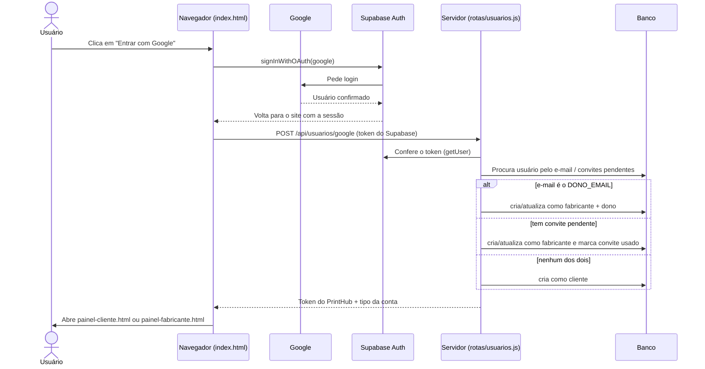
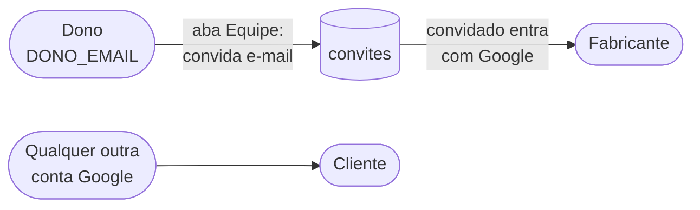
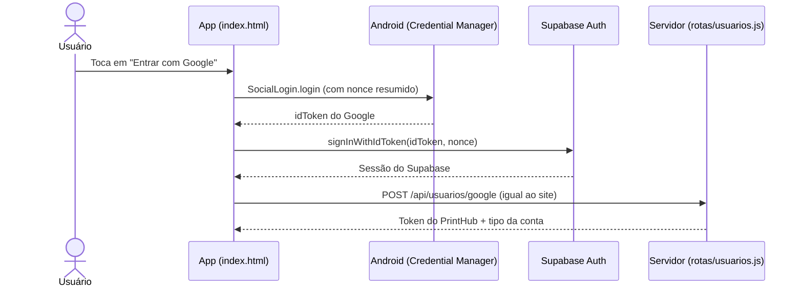
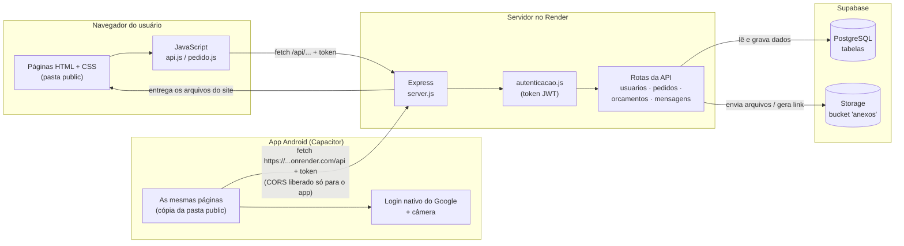
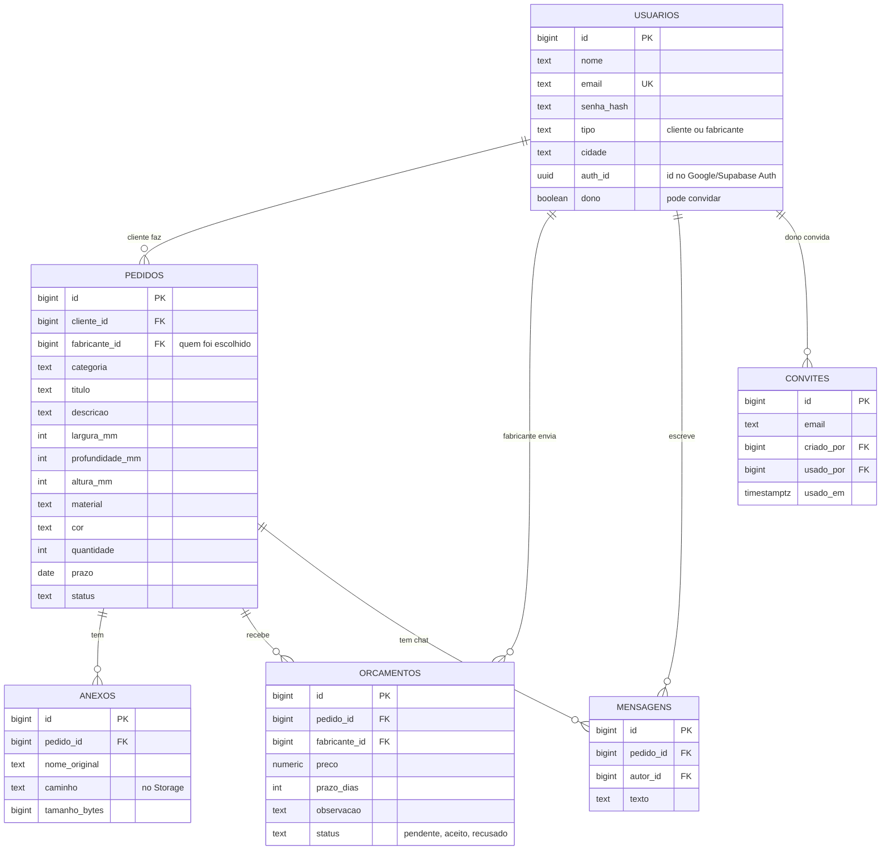
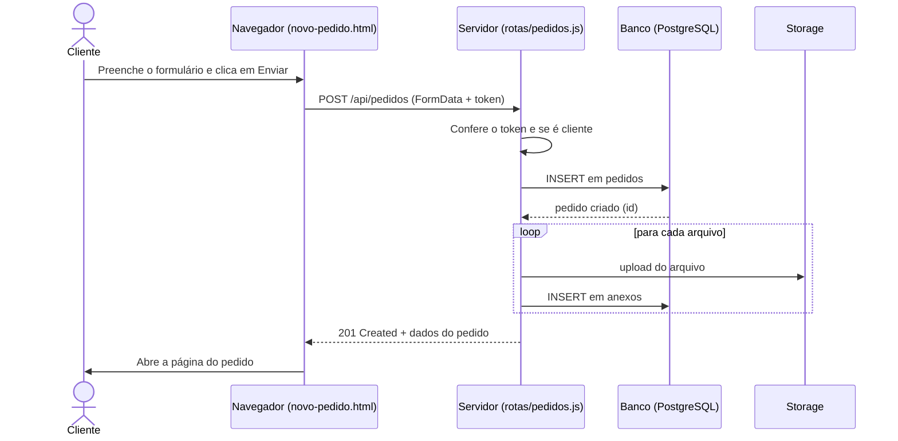

# PrintHub 3D: diagramas para a apresentação

> Os diagramas usam **Mermaid**. Eles aparecem desenhados no GitHub e no VS Code (extensão "Markdown Preview Mermaid").
> Para virar imagem nos slides: cole o código em https://mermaid.live e exporte PNG/SVG.

---

## 1. Fluxo do usuário (do pedido à entrega)

```mermaid
flowchart TD
    A([Cliente entra com Google]) --> B[Escolhe a categoria<br/>ex.: Arquitetura]
    B --> C[Novo pedido:<br/>descrição, dimensões,<br/>material, cor, quantidade]
    C --> D[Anexa imagens ou<br/>arquivo 3D .stl]
    D --> E[[Envia solicitação]]
    E --> F{{Status: aberto}}

    F --> G([Fabricante vê o pedido<br/>no painel])
    G --> H[Analisa a viabilidade<br/>e conversa pelo chat]
    H --> I[[Envia orçamento:<br/>preço + prazo]]
    I --> J{{Status: com_orcamento}}

    J --> K{Cliente compara<br/>orçamentos}
    K -->|Aceita um| L{{Status: aceito}}
    L --> M[Fabricante inicia produção]
    M --> N{{Status: em_producao}}
    N --> O[Fabricante marca<br/>a peça como pronta]
    O --> Q{{Status: pronto}}
    Q --> R[Cliente recebe e toca<br/>em "Recebi o pedido"]
    R --> P([Status: entregue])
```

---

## 1b. Login com Google e papéis





---

## 1c. Login com Google no app Android

O Google não deixa fazer login dentro de um app (WebView). No app usamos a janelinha **nativa** do Android para escolher a conta. O resto é igual ao site.



---

## 2. Arquitetura do sistema



**O app e o site usam o mesmo servidor e o mesmo banco.** A diferença é que no app as páginas já estão dentro do celular (vêm no .apk), então só os dados passam pela internet. Por isso um pedido criado no app aparece no site e vice-versa.

**Ao vivo:** as telas (painéis, pedido e chat) perguntam ao servidor a cada 3 segundos se algo mudou e só redesenham o que mudou. Funciona igual no site e no app.

**Explicando em uma frase:** o navegador nunca fala direto com o banco. Ele sempre pede ao servidor, e o servidor confere quem é a pessoa (token) e o que ela pode fazer antes de mexer no banco.

---

## 3. Banco de dados (tabelas e ligações)



---

## 4. O que acontece quando o cliente clica em "Enviar solicitação"



---

## 5. Rotas da API

| Método | Rota | Quem usa | O que faz |
|---|---|---|---|
| GET | `/api/config` | Todos | URL e chave pública do Supabase (para o botão do Google) |
| POST | `/api/usuarios/google` | Todos | Troca o login do Google pelo token do site e define o papel |
| POST | `/api/usuarios/login` | Contas de teste | Login por e-mail e senha (sem cadastro novo) |
| GET | `/api/usuarios/eu` | Logado | Dados de quem está logado |
| PATCH | `/api/usuarios/eu` | Logado | Atualiza a cidade |
| GET | `/api/convites` | Dono | Convites e fabricantes ativos |
| POST | `/api/convites` | Dono | Convida um e-mail para ser fabricante |
| DELETE | `/api/convites/:id` | Dono | Cancela convite pendente |
| GET | `/api/pedidos` | Logado | Cliente: os pedidos dele. Fabricante: pedidos abertos e os dele |
| POST | `/api/pedidos` | Cliente | Cria pedido com anexos |
| GET | `/api/pedidos/:id` | Logado | Detalhes, anexos e orçamentos |
| PATCH | `/api/pedidos/:id/status` | Fabricante escolhido | Avança para "em produção" e depois "pronto" |
| PATCH | `/api/pedidos/:id/recebido` | Cliente dono | Confirma que recebeu: "pronto" vira "entregue" |
| GET | `/api/app/versao` e `/api/app/pacote.zip` | Qualquer um | Atualização do app Android pelo ar |
| POST | `/api/pedidos/:id/orcamentos` | Fabricante | Envia orçamento |
| POST | `/api/orcamentos/:id/aceitar` | Cliente dono | Aceita um orçamento e recusa os outros |
| GET | `/api/pedidos/:id/mensagens` | Participantes | Lê o chat (`?depois=ID` traz só as novas) |
| POST | `/api/pedidos/:id/mensagens` | Participantes | Envia mensagem no chat |
